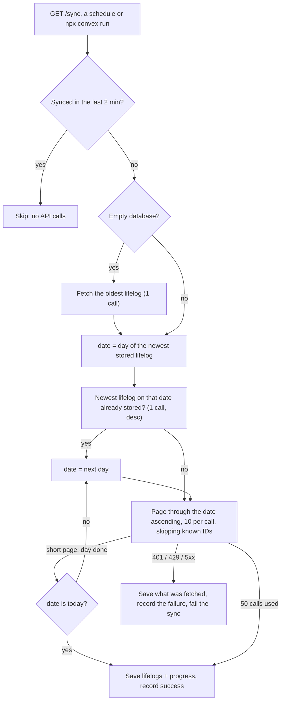

# limitless-convex-db

Your Limitless pendant's lifelogs, mirrored into a Convex deployment you own. A
scheduled sync copies them from the Limitless API without wasting its rate limit,
`/v1/lifelogs` serves them back in the same shape as the official endpoint (so existing
clients only change the base URL), and `/v1/search` adds full-text search over every
transcript.

## Why the sync is the hard part

The Limitless API pages through lifelogs with a cursor, filters by calendar `date`, and
allows 180 requests a minute. A naive mirror breaks in ordinary use:

- **Descending ("newest first") syncs** must reach the last known lifelog in one go. After
  a month away, that can be hundreds of requests.
- **Ascending syncs by date** can't tell whether a day is finished or whether the next
  days are empty, so they either refetch or miss lifelogs.
- **Interrupted syncs** (rate limit, outage, bad key) must neither lose progress nor
  record success.

[`sync-docs.md`](sync-docs.md) is the original design note. The algorithm it arrives at,
in `convex/dashboard/sync.ts`:



So a sync costs one or two calls when nothing is new, at most 50 calls per run, and the
next run resumes from the newest stored lifelog. Known IDs are never stored twice.

## Setup

Requires Node 22+ and a [Limitless API key](https://www.limitless.ai/developers).

```bash
git clone https://github.com/TanGentleman/limitless-convex-db
cd limitless-convex-db
npm ci
npm run typecheck && npm test    # offline; no deployment or API key needed
npx convex dev                   # log in or run locally; pushes the functions and keeps watching
```

In another terminal:

```bash
npx convex env set LIMITLESS_API_KEY <your Limitless API key>
npx convex run dashboard/sync:runSync                     # one sync now
npx convex run extras/schedules:scheduleSync '{"hours": 6}'   # one sync in 6 hours
```

Optional environment variables: `SLACK_WEBHOOK_URL` posts a summary after `/sync`, and
`TIMEZONE` (default UTC) formats dates in those messages.

`npx convex dev --local` runs the open-source backend on your machine instead of the
cloud. It needs glibc 2.39 or newer; on older Linux, run the backend binary in an
`ubuntu:24.04` container.

## HTTP API

Every route on `https://<deployment>.convex.site` requires `X-API-Key: <the same
Limitless API key>`. Without one it answers 401; if `LIMITLESS_API_KEY` isn't set on the
deployment it answers 500 rather than serving anything.

| Route | What it does |
| --- | --- |
| `GET /v1/lifelogs` | Same parameters and response as [the Limitless endpoint](openapi.yml): `timezone`, `date`, `start`, `end`, `cursor`, `direction` (default `desc`), `includeMarkdown`, `includeHeadings`, `isStarred`, `limit` (1-100). |
| `GET /v1/search?query=...` | Full-text search over transcript markdown, with `start`, `end`, `timezone`, `cursor`, `limit`. Returns lifelogs in `data.lifelogs`. |
| `GET /sync` | Runs one sync. 200 when it finished, 500 when it failed. |

```bash
SITE=https://<deployment>.convex.site
curl -H "X-API-Key: $LIMITLESS_API_KEY" "$SITE/v1/lifelogs?date=2025-07-02&timezone=America/Los_Angeles"
curl -H "X-API-Key: $LIMITLESS_API_KEY" "$SITE/v1/search?query=dentist&limit=10"
```

Convex functions are all internal; these routes are the only public surface.

## Search latency

Measured on a local backend (8 cores) with 10,000 synthetic lifelogs (20 a day for 500
days, 150-1,500 words each, 142 MB), timing whole HTTP requests over localhost,
including the key check and JSON:

| Request | p50 | p95 |
| --- | --- | --- |
| `/v1/search`, `limit=10` | 11 ms | 15-29 ms |
| `/v1/search`, `limit=50` | 22-28 ms | 33-91 ms |
| `/v1/lifelogs`, `limit=10` | 10 ms | 14 ms |

A cloud deployment adds network latency; that wasn't measured. To reproduce against your
own local deployment:

```bash
node scripts/bench-search.mjs corpus 10000 > corpus.jsonl
npx convex import --table lifelogs --replace -y corpus.jsonl
LIMITLESS_API_KEY=<deployment key> node scripts/bench-search.mjs run http://127.0.0.1:3211
```

## Tests and limitations

`npm test` runs offline with [`convex-test`](https://www.npmjs.com/package/convex-test):
the HTTP API's compatibility (auth, CORS, dates and timezones, cursors, filters, search),
and the sync against a fake Limitless API (first sync, days longer than a page, resuming
after a gap, reruns, 429 with `retryAfter`, server errors, a bad key).

- **Live sync is untested here.** The tests encode the API's documented behaviour and
  what was observed while building this (a cursor is returned even on a day's last page);
  no run against `api.limitless.ai` was possible without a key.
- After a 429 the sync stops and doesn't retry by itself; the next scheduled run resumes.
- Lifelogs edited upstream after they were synced aren't refreshed, and deletions aren't
  mirrored.
- Dates are UTC days.

Started as a fork of
[limitless-ai-inc/limitless-api-examples](https://github.com/limitless-ai-inc/limitless-api-examples);
`openapi.yml` is from there.
